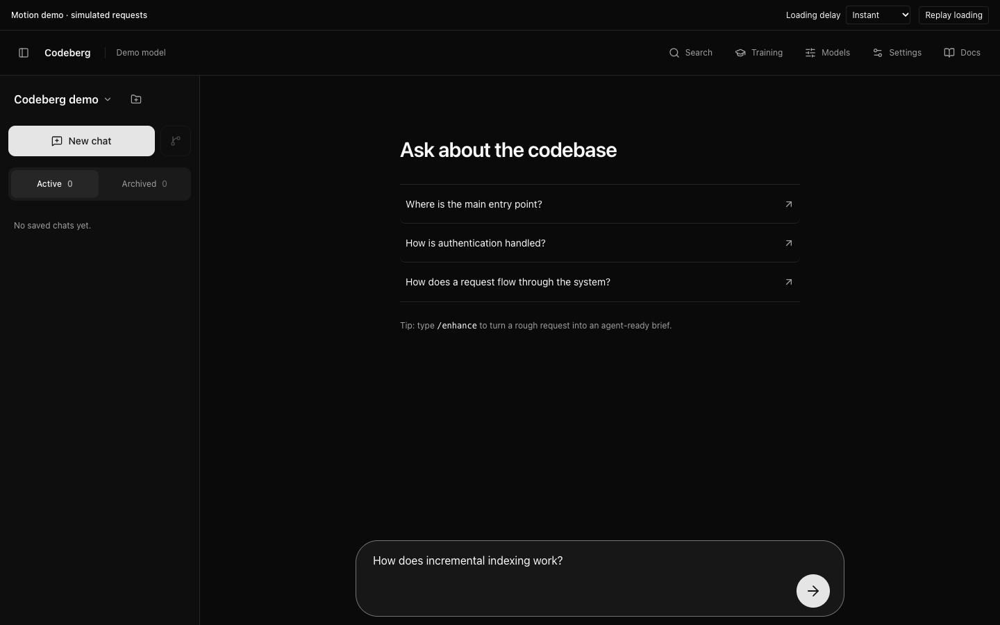

# Codeberg

Codeberg is an agent harness built specifically for code search, with connections
to all of your company's systems through MCP.

It works really well with the setup I have at my workplace.

[](docs/assets/codeberg-ui-demo.mp4)

Click to watch a 22-second UI walkthrough with sample data: chat, model settings,
MCP servers, skills, and training review.

## Install

Supports **macOS 14+ (Apple Silicon or Intel)** and **Linux x64 with glibc
(Ubuntu 22.04+)**.

```sh
curl -fsSL https://github.com/Midwayne/codeberg/releases/latest/download/install.sh | sh
codeberg
```

The installer includes Node, ripgrep, and native libraries; no source build is
needed. It adds the command to `~/.local/bin` and prints PATH instructions if
needed. In the browser, add a project and configure your chat model and provider
credentials. You can also open a repository directly:

```sh
codeberg /path/to/repository
```

Semantic search downloads a separate embedding model on first use. The default
requires **Python 3.10+ with venv and pip**. To use the bundled ONNX runtime
without Python, start with `codeberg --embedding jina-onnx`. To skip embedding
setup and use lexical search and file tools, run `codeberg --no-vector`.
Indexing runs in the background; you can start chatting and searching files
while it finishes.

Stop Codeberg and re-run the installer to upgrade. Configuration, chats, and
indexes stay in `~/.codeberg`.

[Developer setup](docs/development.md)
· [Setup and usage](agent/web-ui/src/docs/content/getting-started.md)

## Why its search is better

Codeberg gives the agent more ways to find relevant code than grep alone or a
standalone vector index:

- **Search by meaning and exact text.** Semantic search finds code from a
  description even when you do not know its identifiers. Hybrid search retrieves
  semantic and lexical candidates independently, combines their rankings, and
  reinforces hits found by both. Exact matches can surface even when vector
  search misses them.
- **Retrieve functions and declarations.** Language-aware parsing preserves code
  boundaries where supported. Results include paths, symbols, line ranges, and
  bounded source context, with full chunks available when the agent needs more.
- **Follow relationships.** Symbol lookup, references, and a structural graph
  help trace callers, imports, and inheritance. Change analysis connects git
  diff hunks to affected symbols and their dependents. Graph links include
  confidence and resolution information; they are syntactic hints, not complete
  type analysis.
- **Keep search current.** File watchers update the index incrementally and reuse
  unchanged embeddings. Saved indexes support warm restarts.
- **Search across repositories.** Query registered repositories together or
  select a subset, with repository, path, and symbol-kind filters to narrow the
  results. See [multi-repo search](docs/multi-repo.md).
- **Keep working during indexing.** Hybrid search can return lexical matches
  while vectors are unavailable, and reference lookup can fall back to grep.
  File reads and text search remain available during index builds.

See the [search tools](daemon/docs/http.md#index-and-search-tools) for details.
