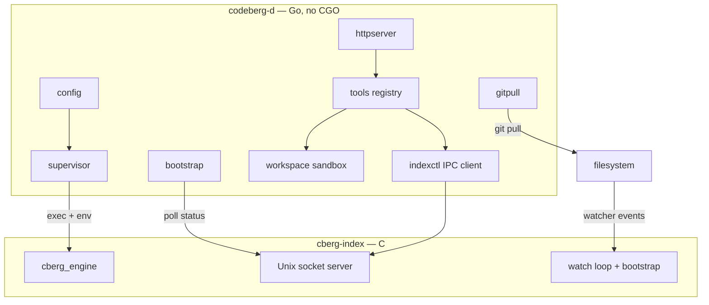

# Daemon architecture

How `codeberg-d` (Go) supervises `cberg-index` (C) and serves the HTTP agent API.

**Related docs:** [http.md](http.md) (agent-facing API), [ipc.md](ipc.md) (indexer wire protocol),
[multi-repo.md](../../docs/multi-repo.md) (multi-root config).

---

## Components



| Package | Role |
|---------|------|
| `cmd/codeberg-d` | Wiring: config → project manager → HTTP; `codeberg-d storage` report |
| `internal/config` | Every daemon and indexer environment variable |
| `internal/storage` | `CODEBERG_HOME` layout: catalog, project directories, index paths, sockets |
| `internal/projects` | Project catalog and per-project indexer runtimes |
| `internal/procenv` | Child-process environment overlay |
| `internal/supervisor` | Spawn, restart, and stop `cberg-index` |
| `internal/bootstrap` | Block until indexer reports `ready` (timeout scales with repo count) |
| `internal/indexctl` | Unix socket client — status, search, tool proxies |
| `internal/httpserver` | `/health`, `/search`, `/tools`, `/tools/call` |
| `internal/tools` | Agent tool registry (grep, search, hybrid_search, …) |
| `internal/workspace` | Path sandboxing, multi-repo resolution, limits |
| `internal/search` | Hybrid vector + lexical reranking |
| `internal/subprocess` | Safe `pipe` tool — allowlisted commands, no shell |
| `internal/gitpull` | Periodic `git pull --ff-only` per served root |
| `internal/git` | `git` subprocess helper |

Indexer implementation: `core/cmd/cberg-index/` — see
[core/docs/CBERG_INDEX.md](../../core/docs/CBERG_INDEX.md).

---

## Startup sequence

1. **Load config** from environment (`config.LoadDaemon`). Invalid values fail
   startup.
2. **Open the project catalog** — `projects.json` under `CODEBERG_HOME`, or a
   temporary home removed at exit when `CODEBERG_NO_INDEX=true`.
3. **Start the default project** — every project, default or not, starts the same
   way: migrate a legacy managed index, exec `cberg-index` with the project's
   roots, socket, index and log directory (other env such as
   `CBERG_EMBED_THREADS` is inherited), then start the optional git pull
   (`CODEBERG_GIT_PULL_INTERVAL_SEC > 0`) and wait in the background for
   `ready` (`bootstrap.StartupTimeout`: `5 min × repo count`, 15–60 min, or
   `CODEBERG_HEALTH_TIMEOUT`).
4. **Listen HTTP** — `127.0.0.1`, default port 48080 (`CODEBERG_HTTP_PORT`).

Configuration and catalog errors and a failed listen are fatal. The supervisor
keeps restarting a crashed indexer with exponential backoff (1 s → 30 s cap).

---

## Shutdown sequence

On `SIGTERM` / `SIGINT`, or after a fatal listen error:

1. HTTP server graceful shutdown (5 s drain).
2. Each running project's supervisor sends `SIGINT` to its `cberg-index`.
3. A `CODEBERG_NO_INDEX` session directory is removed, then the process exits.

---

## Operating modes

| Mode | Env | Vector search | Chunk tools |
|------|-----|---------------|-------------|
| Chunk-only | `CODEBERG_VECTOR=false`, or no `CBERG_MODEL` | `GET /search`: `501 NOT_IMPLEMENTED`; `search` and `hybrid_search` omitted from `/tools` | `find_symbol`, `file_outline`, `get_chunk`, graph tools, grep, … |
| Full | Both set | `GET /search`, `search`, `hybrid_search` | All tools |

`GET /health` exposes `vectors_enabled` and per-repo `ready` / `chunks`.

The launcher selects chunk-only mode with `--no-vector`.
The agent omits `search_code` and `search_bundle` when the daemon does not advertise
`search`. Chunk parsing, graph construction, file watching, and project management
continue. With embeddings enabled, hybrid search retains its lexical fallback
during indexing.

---

## Multi-repo

When `CODEBERG_ROOTS` lists several repos (or a single root without a default key),
`cberg-index` runs one engine with per-repo state. The daemon:

- Resolves `repo` on every tool and search request via `workspace.resolveKey`.
- Merges vector search hits across repos by score when `repo` is omitted.
- Sandboxes file reads to configured roots. Structural tools can join import-backed
  relationships across roots configured together; references also fan out lexical
  lookup when `repo` is omitted. Results retain repository identity. Separately
  selected browser projects remain isolated.

See [multi-repo.md](../../docs/multi-repo.md).

---

## Security model (summary)

- **Workspace sandbox:** relative paths only; `..` and absolute paths rejected;
  symlinks resolved and must stay under repo root (`403 FORBIDDEN` on escape).
- **Pipe tool:** no shell; allowlisted commands only; denied write/exec flags.
- **Limits:** grep 200 matches, glob 500 files, read_file 64 KiB content, pipe 256 KiB
  stdout, 15 s subprocess timeout — see [http.md](http.md).

---

## Testing

```sh
make daemon-test   # go test ./... in daemon/
```

Mock Unix socket tests in `internal/indexctl/client_test.go` and HTTP integration
in `internal/httpserver/server_test.go`. No full supervisor + real `cberg-index`
integration test in Go — use manual `make run-daemon` for end-to-end checks.
