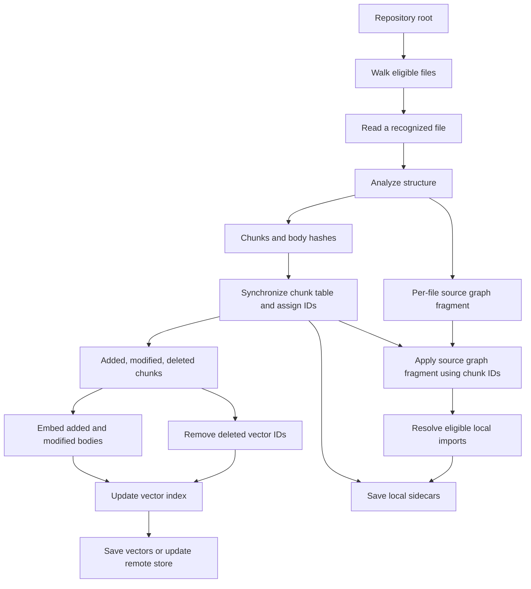
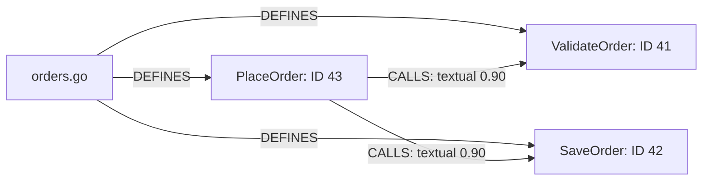

# How Codeberg's indexer works

This guide explains the implementation in this checkout: how files become
chunks, how the source graph is built, how embeddings are produced and searched,
and how all of this stays current as files change. It describes implemented
behavior, including limitations, rather than a proposed design.

## 1. What the indexer builds

Codeberg maintains several complementary views of a repository:

| Structure | What it represents | What it is used for |
| --- | --- | --- |
| Chunk table | Named source regions, their identities, byte/line spans, and content hashes | Symbol lookup, file outlines, retrieving chunks, tracking changes |
| Source graph | Files, symbols, imports, calls, containment, and inheritance | Callers, dependencies, architecture, and change impact |
| Vector index | A numerical embedding for each indexed chunk | Finding code by meaning |
| File manifest | File hashes and directory hash rollups, plus file size and modification time | Finding changes across restarts without reparsing everything |

The chunk table connects the retrieval structures. A function's stored chunk ID
is also its vector key and its source graph symbol ID. File and module graph
nodes use a separate synthetic ID space.

There are also several different kinds of **trees and graphs** involved:

* A **syntax tree** describes the grammatical structure of one source file.
* The **source graph** describes relationships among files and code symbols.
* The default vector backend's **HNSW graph** connects nearby embedding vectors
  so approximate nearest-neighbor searches can avoid scanning every vector.
* The **manifest tree** rolls file hashes up through directories to detect
  unchanged subtrees.

An HNSW neighbor relationship means two vectors are close. It does not mean one
function calls another. A source graph call edge is extracted from syntax; it
is not inferred from vector similarity.



The embedding branch is optional. Chunking, symbol lookup, and source graph
construction do not require an embedding model or a chat model.

## 2. Which process does what

The C program `cberg-index` owns parsing, chunk tracking, graph construction,
embedding orchestration, vector operations, and file watching. It uses the
`libcodeberg` modules under `core/src/`.

The Go daemon, `codeberg-d`, starts and supervises indexer processes and exposes
HTTP endpoints and agent tools. It communicates with the C indexer over a Unix
socket. The TypeScript agent and browser UI consume these services.

A project can contain multiple repository roots. Within one C engine, each root
has its own chunk table, watcher, manifest, graph, vector index, readiness, and
progress. The engine shares its chunker/parser cache and embedding model across
those roots. Root bootstraps run sequentially because model inference is a
shared bottleneck. A failed root can remain unavailable while sibling roots
finish successfully.

The project manager starts the startup project's indexer at launch; other
project indexers start on demand. Thus “one shared embedder” means one per C
engine, not necessarily one model instance for every project process.

The C executable starts its IPC server before bootstrapping repositories. Status
can therefore report preparation progress while indexing is still running.
The daemon's lexical search and filesystem tools provide useful access before
index-dependent tools become ready.

Source: [main.c](../core/cmd/cberg-index/main.c),
[indexer.c](../core/cmd/cberg-index/indexer.c),
[project indexer setup](../daemon/internal/projects/indexer.go), and
[IPC protocol](../daemon/docs/ipc.md).

## 3. How files are selected

The indexer walks the root and processes regular files. The cold file walker
uses `lstat`, so symlinks are not followed as regular source files or traversed
as directories.

A shared directory-name policy skips common generated, dependency, and metadata
directories, including `.git`, `node_modules`, `vendor`, `.venv`, `__pycache__`,
`.next`, `dist`, `build`, `target`, `.gradle`, `.idea`, and `.terraform`.

This C scanner uses its own policy. It does not implement a general `.gitignore`
interpreter. A directory such as `third_party` is not automatically excluded by
this list, so recognized source files there can materially increase index size.

Language selection comes from the file extension. Recognized extensions route
to code, Markdown, or configuration chunkers. For example, `.ts` and `.tsx`
select TypeScript, `.c` and `.h` select C, and `.rs` selects Rust. The current
TypeScript descriptor uses the TypeScript grammar for both `.ts` and `.tsx`;
extension recognition alone does not promise complete syntax coverage.

The library exposes a generic 50-line fallback chunker for unknown languages,
but the production indexer's `parse_file` skips unknown extensions before
calling that library path. Consequently, “the library can window arbitrary
text” does not mean “the running indexer embeds every file.”

Source: [walk policy](../core/src/common/walk_policy.c),
[skip list](../core/src/common/walk_skip_dirs_gen.inc),
[filesystem walker](../core/src/common/pathutil.c),
[language detection](../core/src/common/lang.c), and `parse_file` in
[indexer.c](../core/cmd/cberg-index/indexer.c).

## 4. What automatic chunking means

Automatic chunking is deterministic structural analysis. The indexer chooses
boundaries using language syntax or format-specific rules. It does not ask an
LLM where to split a file, and it does not train a boundary detector for each
repository.

A chunk contains:

* A repository-relative path.
* A kind, such as function, method, class, struct, interface, section, or key.
* An optional symbol or section name.
* A stable textual key.
* Start/end byte offsets and one-based source line coordinates.
* A hash of the exact bytes inside its span.

After synchronization, the stored chunk also has  a numeric ID. The chunk table
stores metadata; it does not store an independent full copy of every chunk's
text. Embedding and retrieval read the source file and slice the recorded span.

### Code: parse once, capture definitions

For grammar-backed languages, Codeberg uses Tree-sitter. The parser converts
source text into a syntax tree. Language-specific Tree-sitter queries then
capture definition nodes and their names.

For example, a Go function query identifies a `function_declaration`, captures
its identifier as `@name`, and captures the full declaration as `@function`.
The full node's byte and line coordinates become the chunk span.

Current definition extraction covers:

| Language | Captured definitions |
| --- | --- |
| Go | Functions, methods, structs, interfaces |
| C | Function definitions, including several pointer-return declarator shapes; named struct definitions |
| JavaScript | Functions, classes, methods, module-level lexical declarations with function values |
| TypeScript | Functions, classes, interfaces, methods, module-level lexical declarations with function values |
| Python | Functions and classes |
| Java | Classes, interfaces, methods, constructors recorded as methods |
| Kotlin | Functions and classes |
| Rust | Functions, structs, enums recorded as structs, traits recorded as interfaces |
| Ruby | Methods, singleton methods, classes, modules recorded as classes |

JavaScript/TypeScript function-valued lexical declarations include arrow
functions, function expressions, and generator functions at module level,
including exported declarations. The dedicated rule avoids turning nested
function-valued lexical declarations into separate chunks. Other definition
queries can still capture nested named definitions.

Chunks are sorted by starting byte offset. They do not necessarily partition a
file into disjoint pieces: a class chunk can include its entire body while its
methods also have their own chunks. This gives retrieval both a larger type
context and focused method contexts, at the cost of overlapping text and vectors.

Conversely, the query path does not fill every gap between definitions. Imports,
top-level expressions, constants, comments, or declarations outside the selected
patterns may have no dedicated vector chunk. A recognized code file with no
matching definitions can produce zero chunks; it is not automatically converted
into 50-line windows. Its graph fragment can still represent the file and
recognized references.

Code chunks are not recursively divided to fit an embedding token budget. A
large function remains one function chunk, and a large class can remain one
class chunk. Model input truncation is a later, separate step.

Parsers and compiled queries are cached by language. The current analysis call
still parses each changed file as a whole: it passes `NULL` as Tree-sitter's old
tree and deletes the resulting tree afterward. Incremental indexing here means
selective file processing and selective embedding; it does not currently mean
retaining syntax trees and applying Tree-sitter edit deltas.

### Markdown: heading sections

Markdown uses a line-based chunker rather than Tree-sitter. An ATX heading,
such as `## Installation`, starts a section extending to the next heading of
any level. Enclosing headings form a breadcrumb symbol, for example
`Setup > Installation > Linux`.

Nonblank text before the first heading becomes a preamble section. Headings
inside fenced code blocks do not split sections. Sections longer than 200 lines
continue as additional chunks with the same breadcrumb and successive
occurrence numbers. Setext headings such as a title followed by `===` are not
handled as heading boundaries by this implementation.

### YAML, TOML, and JSON: structural configuration sections

These formats also use custom chunkers:

| Format | Boundary rule |
| --- | --- |
| YAML | Top-level, column-zero key lines |
| TOML | Table and array-of-table headers, such as `[server]` and `[[jobs]]` |
| JSON | Keys of the root object |

This is shallow configuration structure rather than a full semantic model of
every nested value. A YAML top-level key includes its nested block. A JSON
root key includes its associated value, which may itself be a large object.

The JSON scanner is string-aware and skips JSONC line/block comments. Malformed
or unsupported JSON root shapes, including non-object roots, fall back to
50-line windows. Long configuration sections continue in chunks of at most
200 lines under the same symbol. Configuration and Markdown chunks do not
produce source graph fragments.

Source: [chunker.c](../core/src/chunk/chunker.c).

## 5. Chunk identity, hashes, and change classification

Identity and content are tracked separately.

The textual key has this shape:

```text
<relative-path>::<numeric-kind>::<symbol>#<occurrence>
```

For readability, one might describe a key as
`src/cache.go::<function-kind>::Load#0`; the actual serialized kind is an integer.
The occurrence number distinguishes repeated definitions with the same path,
kind, and symbol. It is assigned during extraction; it is not a globally unique
symbol name or a package-qualified compiler identity.

The chunk table assigns monotonically increasing numeric IDs and retains them
when keys survive an edit. IDs are local to a root's table. Multi-root callers
must preserve repository identity alongside a numeric chunk ID.

The content hash is computed over the exact source span using XXH3-128. It is
a fast change detector, not an embedding and not a cryptographic integrity proof.

Synchronization compares the incoming complete chunk set against the old table:

| Condition | Classification | Vector work |
| --- | --- | --- |
| Key absent from old table | Added; assign a new ID | Embed and add |
| Key exists and body hash changes | Modified; retain the ID | Embed and replace |
| Key exists and body hash matches | Unchanged | Reuse existing vector |
| Old key absent from incoming set | Deleted | Remove old vector ID |

Editing a function body usually retains its ID while changing its vector.
Renaming the function or moving its file changes its key, so it generally looks
like a deletion and an addition. Reordering identical-name definitions can also
change which body gets a particular occurrence number.

The table builds replacement state before committing it, so a failed table sync
does not partially overwrite the live table. Its fingerprint combines sorted
keys and body hashes, making it insensitive to enumeration order.

There is a current metadata caveat: the ordinary unchanged-hash path copies the
previous stored chunk metadata, and the fast identical-table check compares
keys and hashes without comparing spans. Therefore a chunk whose bytes remain
identical but shift within a file can retain old stored offsets. Stable IDs and
vector reuse are implemented; universally refreshing moved spans is not
guaranteed by the current code. Since later reads slice the live file, stale
offsets can affect returned text as well as displayed locations. This guide
records that behavior; it does not change it.

Source: [chunk keys](../core/src/chunk/chunk_keys.c),
[chunk table](../core/src/chunk/chunk_table.c), and
[hashing](../core/src/common/hash.c).

## 6. How the source graph is constructed

The graph describes recognizable source relationships. It is independent of
the embedding model and does not contain learned semantic similarities.

### One syntax tree feeds both chunks and graph extraction

`cberg_chunker_analyze` first extracts chunks. Before releasing the same
Tree-sitter tree, it passes the tree and chunks to the graph extractor. This
avoids parsing the file twice during the normal combined analysis path.

Symbol chunks supply graph definitions directly. Additional language-specific
queries capture call names, imports, superclass/interface names, and certain
membership relationships. The result is a temporary per-file graph fragment.

The chunk table is synchronized before that fragment is applied. At apply time,
the graph resolves each definition's chunk key to its stored numeric ID. This
ordering is what aligns source graph symbols with chunks and vectors.

### Nodes and edges

| Node kind | Meaning |
| --- | --- |
| `FILE` | A recognized grammar-backed source file |
| `FUNCTION`, `METHOD`, `CLASS`, `STRUCT`, `INTERFACE` | A captured definition, using its chunk ID |
| `MODULE` | An import string that has not been rewritten to a local file |

File/module nodes have synthetic IDs with the high bit set. A symbol's `qname`
currently contains its chunk key, rather than a fully resolved language-level
qualified name.

| Edge kind | Example | Construction |
| --- | --- | --- |
| `DEFINES` | File → function | Synthesized from live nodes when queried |
| `CONTAINS` | Class → method | Definition span nesting, or receiver/impl membership |
| `IMPORTS` | File → module or local file | Import captures, followed by optional path resolution |
| `CALLS` | Caller → callee candidate | Call-site capture plus query-time name resolution |
| `INHERITS` | Subtype → base/interface candidate | Inheritance capture plus query-time name resolution |
| `REFERENCES` | General symbol usage | Reserved; not currently extracted as a general relation |

For ordinary nesting, the extractor chooses the smallest enclosing captured
class, struct, or interface. Go methods and Rust impl methods can be outside
their type's source span, so explicit receiver/impl queries add reversed
membership references: resolving a method's container name produces a
container → method `CONTAINS` edge.

A call belongs to the smallest captured definition containing its source
position. If no definition encloses it, its source is the file node. This is
syntax containment, not full lexical scope or runtime dispatch analysis.

Repeated references from the same source definition to the same target name
and relation kind are deduplicated. Calling `save()` twenty times in a function
usually creates one stored named call reference, retaining the first line.
Graph call degree therefore does not measure the number of execution-time
calls or enumerate every source call site.

### Why calls store names rather than fixed target IDs

Many call expressions only supply a name such as `save`. A member expression
may capture the property name without proving the receiver's type. Persistently
binding such a reference to one definition would create brittle guesses.

Instead, call and inheritance references generally retain their target name.
When a query asks for outgoing/incoming edges or a traversal, the store resolves
that name against live definitions:

1. Restrict candidates to suitable node kinds for the relationship.
2. Prefer same-file matches and discard cross-file candidates if local matches
   exist.
3. Otherwise consider matching definitions across that root.
4. Return at most eight candidates per reference.

The resulting edges carry heuristic confidence:

| Resolution case | Confidence |
| --- | --- |
| Direct/pre-resolved structural edge, such as nested containment | `1.0` |
| Same-file textual name match | `0.90` |
| Cross-file textual match with `n` candidates | `0.75 × min(1, 3/n)` |
| Import rewritten to a local file | `0.95` |

For one, two, or three cross-file candidates, the formula remains `0.75` per
candidate; larger candidate sets receive a penalty. These values are heuristic
strengths, not calibrated probabilities.

An unresolved call with no matching live definition produces no resolved call
edge. This is common for library APIs outside the indexed root. Deleting a
definition removes it from future name resolution, so named references do not
retain stale hard links to that deleted symbol.

This is currently the `fast` syntactic graph mode. It does not run an LSP or
compiler type checker to prove overload selection, receiver types, virtual
dispatch, aliases, or cross-language bindings. `moderate` and `full` modes are
not implemented; selecting them warns and falls back to `fast`.

### Import resolution is a separate pass

Imports initially point at module nodes. A later pass uses repository paths,
source-file candidates, and the module prefix in `go.mod` to rewrite safe
matches to actual file nodes.

Eligible shapes include relative imports, Rust paths containing `::`, imports
matching the current Go module prefix, multi-segment dotted paths, and paths
with source-file extensions. Bare names such as `fmt`, `json`, and `os` are
not rewritten merely because a similarly named local file exists. Slash-form
stdlib/npm imports are also left alone unless another safe rule applies.

Unresolved imports keep their module nodes. Resolving a Go package import onto
a file remains a path-based structural approximation, not complete package
semantics. The resolver does not make call edges compiler-accurate or fully
connect imported aliases to call targets.

Import resolution runs after cold/warm bootstrap and after successful watched
updates. An import cache tracks changed and deleted paths. Already resolved
file imports are left alone by the rewrite pass; it is not a complete compiler
dependency reanalysis on every update.

### Graph updates and queries

Applying a fragment replaces that file's prior graph contribution. Deleted
files have their nodes and references removed. The store uses tombstones and
compaction to reclaim dead records, including orphan module nodes.

Queries include exact-name node search, incoming/outgoing edges, and bounded
breadth-first traversal. Hubs are ranked by incident resolved `CALLS` degree
(incoming plus outgoing); these are useful architecture hints, not runtime
profiling measurements.

Graph application and import-resolution failures are generally logged without
discarding a successful chunk/vector update. Graph extraction errors inside
the combined analysis function can still propagate as parse/indexing errors;
the graph is not unconditionally failure-isolated at every stage.

Source: [graph extraction](../core/src/graph/graph_extract.c),
[graph store](../core/src/graph/graph_store.c),
[import resolution](../core/src/graph/resolve_pkg.c), and
[graph module reference](../core/docs/modules/graph.md).

## 7. How embeddings are produced

An embedding is a fixed-length numerical representation of text. The trained
model aims to place related code and queries near one another in vector space.
Individual coordinates are not exposed as labeled concepts such as
“authentication” or “database”; their meaning is distributed across the vector.

Codeberg runs inference using a selected pretrained embedding model. Indexing
does not fine-tune that model, update the chat model, or perform post-training.
The separate Learning system serves different purposes.

### What text goes into the model

The indexer reads the bytes inside each chunk's recorded source span. It does
not automatically append the repository path, graph neighbors, enclosing file
imports, or a generated natural-language summary to each document. Some model
adapters add the model's required task prefix.

For example, two byte-identical chunk bodies in different files can share an
embedding computation because the document input is identical. They still
remain separate chunk IDs and separate entries in the vector index.

This also explains why an isolated method may lack useful surrounding imports
in its vector input. The separate class chunk, source graph, file reads, and
hybrid lexical results can supply additional evidence during retrieval.

### Current model/runtime paths

New launcher installations default to EmbeddingGemma 2: the MLX FP32 text path
on Apple Silicon and the Sentence Transformers FP32 text path elsewhere.
Existing configured model choices are retained. The C engine itself chooses
between an ONNX implementation and an external worker based on configuration;
it does not independently pick the launcher's preferred model.

| Path | Processing | Current input limit |
| --- | --- | --- |
| EmbeddingGemma 2 / Sentence Transformers | Load local text model, apply saved prompt/pooling/projection/normalization modules | 8,192 tokens including prompt |
| EmbeddingGemma 2 / MLX | Load converted unquantized FP32 text model and obtain its text embeddings | 8,192 tokens including prefix |
| Jina / ONNX | Tokenize, transformer inference, mean pooling, L2 normalization | 256 tokens in the C adapter |
| Existing Qwen / MLX | Tokenize and use the MLX embedding output | 512 tokens in this adapter |
| Existing llama.cpp worker | Call a locally owned `llama-server` embedding endpoint with last pooling | Runtime/model dependent |

EmbeddingGemma 2 currently produces 768-dimensional vectors. Its workers
disable vision/audio processing and use FP32. This configuration indexes text;
it does not index images, audio, or video.

The Sentence Transformers worker selects `Document` for stored chunks and
`CodeRetrieval` for queries. The MLX Gemma adapter explicitly prefixes documents
with `title: none | text: ` and queries with
`task: code retrieval | query: `. Distinct prompts teach the pretrained encoder
which retrieval role each input is serving; they do not train it at indexing time.

The ONNX path currently dispatches documents and queries through the same
tokenization/inference routine. Older Qwen workers retain their original
count-only protocol, without the new query/document mode flag.

### The persistent worker protocol

For Python-backed runtimes, C forks a persistent worker and connects pipes to its
stdin/stdout. The worker loads the model once, performs a trial embedding, and
announces `READY <dimension>`.

Each request contains a binary text count followed by length-prefixed UTF-8
bodies. The response contains contiguous float32 vectors. The Gemma-compatible
protocol marks query requests with the high bit of the count. Diagnostics go
to stderr so logging cannot corrupt the binary output stream.

The worker validates vector dimensions and finite values. C also L2-normalizes
worker output. Keeping the process alive avoids paying model startup cost for
every chunk or query.

### The ONNX path in more detail

1. Load the model and its tokenizer from local files.
2. Tokenize every input in the call. The adapter keeps at most 256 tokens,
   preserving the closing special token when truncating.
3. Sort tokenized rows by length.
4. Build batches, normally up to 16 rows, padding each batch to its own longest
   row. Construct input IDs, attention masks, and token-type IDs as required.
5. Run the transformer to obtain per-token hidden states.
6. Average the nonpadding token positions into one vector per input.
7. L2-normalize each vector and restore the caller's original input order.

Conceptually, for token representations `h₁ ... hₜ`:

```text
pooled = (h₁ + h₂ + ... + hₜ) / t
embedding = pooled / ||pooled||₂
```

Long functions are truncated by the model adapter rather than split into
multiple token-sized function chunks. Text beyond the effective token limit
does not contribute to that chunk's vector, even though retrieval can read the
full stored source span.

Source: [embedding facade](../core/src/embed/embed.c),
[worker bridge](../core/src/embed/embed_worker.c),
[Python worker](../scripts/embedding_worker.py),
[Gemma MLX adapter](../scripts/embedding_gemma_mlx.py),
[ONNX implementation](../core/src/embed/embed_onnx.c),
[tokenization](../core/src/embed/tokenize.c), and
[launcher model catalog](../launcher/internal/embedding/models.go).

## 8. How embedding work is reduced and scheduled

The first saving is **incremental reuse**: unchanged chunk hashes retain their
saved vectors. A modified file does not automatically force every chunk in that
file, much less every repository chunk, through inference again.

The second saving is **duplicate-body reuse within an embedding operation**.
The indexer groups the added/modified rows by content hash, confirms a hash
prefix match against the full stored hash, embeds one representative, and
inserts that vector under each member's chunk ID. It does not maintain a
universal historical content-addressed embedding cache across every operation.

The third saving is **length-aware batching**. The indexer handles up to 1,024
representative chunks in a window, reads their source slices, sorts by byte
length, and sends bounded calls to the embedder. Similar-length sequences
reduce padding waste in transformer batches.

Each outer call has at most 96 texts and a 32 KiB *estimated cost* budget. Each
text contributes `min(actual_bytes, 1024)` to that estimate. This is not a hard
32 KiB payload limit, a token limit, or a truncation rule. The heuristic was
designed around the short ONNX input window and is also used for worker calls.
It does not guarantee a particular latency for a long-context Gemma batch.

Inside an ONNX call, token-length sorting and normally 16-row inference batches
provide a second batching layer. Gemma's Python adapters currently use batches
of eight. These runtime batches differ from the indexer's 96-text call limit.

An engine mutex serializes access to the shared embedder. The indexer releases
it between bounded calls so query embedding has opportunities to run. Repository
updates also hold the affected repository's mutex through synchronization and
vector updates. Consequently, bounded embedder calls reduce shared-model
contention but do not guarantee that searches on an updating root never wait.

After 300 seconds without embedding use, the default idle policy unloads the
model/worker. Chunk metadata, graphs, vectors, and watching remain available.
The next semantic query or embedding update reloads the model. Setting
`CBERG_EMBED_IDLE_SECONDS=0` disables this unloading.

Source: `embed_unique`, `embed_window`, and `call_len` in
[indexer.c](../core/cmd/cberg-index/indexer.c), and
[embedding lifecycle](../core/cmd/cberg-index/embedding.c).

## 9. How vector search and hybrid retrieval work

The vector provider receives `(chunk_id, vector)` entries. The default local
provider is usearch with cosine distance and an HNSW approximate search index.
Qdrant and pgvector are alternatives; the chunk table, manifest, and source
graph remain local sidecars even when vectors are stored remotely.

For vectors `q` and `v`, cosine similarity is:

```text
similarity(q, v) = dot(q, v) / (||q||₂ × ||v||₂)
```

Normalized vectors have norms close to one, making the score approximately a
dot product. The usearch adapter converts returned distance to similarity with
`score = 1 - distance`. A similarity score is a ranking signal, not a probability
that the code answers the user's question.

HNSW organizes vectors into a navigable neighborhood graph. Search follows
promising neighborhoods instead of exhaustively comparing the query to all
chunks. It is approximate: a fast search can miss an exact nearest neighbor.
The default configuration uses connectivity 16, insertion expansion 128, and
search expansion 64. Query orchestration can increase search effort with `k`.

New local indexes default to **int8 vector storage**; float32 storage is
configurable. This is separate from **FP32 model inference**. A model may run
in FP32, return float32 embeddings, and have those embeddings quantized to int8
inside the vector store. Quantization reduces storage while introducing
approximation. The adapter also installs a corrected int8 cosine metric for
the bundled usearch version's zero-dot-product case.

A semantic query follows this path:

1. Embed the query once using the query mode supported by the selected runtime.
2. Search one requested root or each ready root's vector index.
3. Look up returned IDs in that root's chunk table.
4. Apply path, chunk-kind, and score filters.
5. Read snippets from current source files using stored spans.
6. For cross-root search, merge candidates by score and return the top results.

The current engine caps final semantic results at 64. With filters, it retrieves
more vector candidates, starting at 64 and increasing to at most 256, to try to
fill the requested result count. This bounded post-filtering can still return
fewer results than requested even when more matching chunks exist elsewhere in
the index.

The Go daemon's **hybrid search** adds an independent lexical path. It starts
vector retrieval and ripgrep retrieval concurrently, extracts useful lexical
query terms, then combines the ranked candidates using reciprocal-rank fusion.
A lexical match inside a vector chunk reinforces that chunk. Other lexical
matches can survive as their own citeable hits with `id=0`.

The fusion also uses weaker supporting evidence from the same file, small
source/test/generated-file weights, and a diversity pass that tries to avoid
letting more than three hits from one file crowd out available alternatives.
Top results receive bounded source context. When vectors are disabled or not
ready, supported unavailability conditions permit lexical-only hybrid results.

Graph traversal is a separate tool path. The existence of both graph and vector
indexes does not mean ordinary semantic search automatically traverses graph
neighbors or embeds a graph-expanded document.

Source: [usearch provider](../core/src/search/providers/usearch/usearch.c),
[index defaults](../core/src/search/index_config.c),
[search orchestration](../core/src/search/search.c),
[engine search](../core/cmd/cberg-index/indexer.c),
[daemon hybrid search](../daemon/internal/tools/hybrid.go), and
[fusion/ranking](../daemon/internal/search/ranking.go).

## 10. First index, live updates, and warm restart

### First index: cold bootstrap

1. Initialize the engine and open the shared embedding model when vector mode
   is enabled.
2. Resolve configured roots and open per-root state, vector stores, and watchers.
3. Start IPC, then bootstrap roots sequentially.
4. Walk each root, read recognized files, extract chunks and graph fragments,
   and hash chunk bodies.
5. Synchronize the chunk table and assign IDs.
6. Apply graph fragments against those IDs.
7. Embed unique added bodies and insert all chunk vector IDs; save vectors.
8. Build the file manifest and resolve eligible imports.
9. Mark the root ready and save local state.

During a cold parse, total chunks are not yet known. Progress can therefore
show “Counting chunks.” Later stages report measured chunk counts, graph work,
or finalization. Duplicate bodies count as stored chunks even when they save
model inference work. These stages are not a single calibrated end-to-end
percentage.

### Live updates: watcher-driven synchronization

Watch backends use inotify on Linux, FSEvents on macOS, or a polling fallback.
Dirty events are coalesced by relative path. Repeated notifications therefore
lead toward one pending file action rather than one parse per raw OS event.
This is eventual background synchronization, not an instantaneous transaction
with every editor keystroke.

For an update batch, the engine:

1. Separates changed/created paths from deleted paths.
2. Carries forward existing chunks from unaffected files.
3. Re-reads and re-analyzes changed files.
4. Synchronizes the union against the previous table to obtain chunk deltas.
5. Replaces affected graph fragments and removes deleted file graph state.
6. Embeds added/modified chunk bodies and removes deleted vector IDs.
7. Resolves imports, saves chunks and graph, and publishes progress/status.

Only affected files are parsed, but synchronization still assembles and compares
a repository-wide chunk view. This is not a guarantee of constant work
independent of repository size for a one-file edit.

Successful watched updates preserve the last completed readiness while exposing
active indexing status. A vector failure can clear readiness and trigger
recovery. The manifest baseline is refreshed on clean shutdown rather than
rewritten after every watched batch, while chunks and graph are saved after
successful updates.

### Warm restart: reconcile disk state with saved metadata

The indexer first reloads the saved chunk table, preserving IDs, and attempts to
reload the graph. It then loads the previous manifest and walks the current
filesystem to rebuild a fresh manifest.

For a file whose size and nanosecond modification time match the saved values,
the rebuild reuses its old hash without reading the file body. Other files are
read and hashed. The manifest organizes file hashes into directory rollups;
comparing two trees can skip a whole unchanged directory subtree when its
rollup hashes match.

Rebuilding the fresh manifest still enumerates/stats the tree. The hash-pruned
diff is efficient after that rebuild; it does not make all warm startup work
proportional only to changed files. The size/mtime shortcut also assumes that
changed bytes are reflected in those metadata fields.

The manifest diff returns added, modified, and deleted file paths. Only added
and modified paths are re-chunked; deleted paths are removed. The chunk-level
hash comparison then avoids re-embedding unchanged bodies within those files.

If the graph sidecar is missing or incompatible, the graph can be re-extracted
from source while keeping a valid chunk table and vectors. If the manifest is
missing/incompatible, the indexer re-chunks the tree, but preserved chunk keys
and hashes can still avoid unnecessary embedding work.

The manifest version includes a chunking-rules version. When chunk output rules
change and that version is bumped, the old manifest becomes incompatible, so
the next startup re-chunks files even when their bytes have not changed.

Source: [watch implementation](../core/src/watch/watch.c),
[manifest implementation](../core/src/manifest/manifest.c),
[chunking rules version](../core/src/chunk/chunk_rules.h), and
bootstrap/update functions in [indexer.c](../core/cmd/cberg-index/indexer.c).

## 11. What is persisted and how recovery works

Within a root, the C engine derives paths from the configured base and a hash
of the resolved root:

```text
<base>.<root-hash>             vector index for the local usearch backend
<base>.<root-hash>.chunks      chunk metadata, numeric IDs, next ID
<base>.<root-hash>.manifest    file hashes and size/mtime baseline
<base>.<root-hash>.graph       source graph snapshot
```

The launcher also separates selected embedding model caches. Compatible
document/query embedding spaces must be preserved: equal vector dimensions
alone do not make embeddings from two models interchangeable. Low-level custom
component runs must use compatible model and index configurations themselves.

Chunk, manifest, graph, and local vector snapshots use temporary files followed
by rename. This protects replacement of each individual snapshot. The four
artifacts are not one atomic cross-file database transaction, so a kill between
saves can leave them at different generations.

The update code includes recovery behavior, such as accepting deletion of a
vector ID that is already absent. Vector I/O/internal failures receive bounded
retries; persistent apply failures can trigger rebuilding the vector index.
Corrupt or dimension-incompatible vector stores can trigger a deliberate wipe
and reindex, whereas a transient unavailable remote service is not treated as
corruption and wiped on open.

Sidecars can also be saved in chunk-only mode when an index base is configured.
The absence of an embedding model does not require rebuilding all source graph
information on every restart.

These files are derived search data. They are distinct from chat history,
accumulated Knowledge, and reviewed Learning datasets.

Source: state save/load and vector recovery in
[indexer.c](../core/cmd/cberg-index/indexer.c),
[chunk serialization](../core/src/chunk/chunk_table.c),
[graph serialization](../core/src/graph/graph_store.c), and
[vector provider reference](../core/docs/VECTOR_INDEX_PROVIDERS.md).

## 12. Worked example: one file through the whole system

Consider this Go file, with three functions:

```go
package orders

func ValidateOrder(id string) bool {
    return id != ""
}

func SaveOrder(id string) error {
    return nil
}

func PlaceOrder(id string) error {
    if !ValidateOrder(id) {
        return nil
    }

    return SaveOrder(id)
}
```

**Chunking:** the Go definition query produces three function chunks. Each
chunk covers one declaration, has its own body hash, and receives a key based
on path, function kind, name, and occurrence. The package clause is outside
those function spans.

**Identity:** suppose the table assigns IDs 41, 42, and 43. The graph definition
nodes and vector entries use those same IDs within this root.

**Graph:** the file defines all three functions. The fragment records two call
names from `PlaceOrder`: `ValidateOrder` and `SaveOrder`. Queries resolve both
against same-file definitions and return textual call edges at confidence 0.90.



**Embeddings:** each function's text becomes a document vector. A semantic query
such as “where is an order checked before it is saved?” is encoded as a query
vector. The model may rank `PlaceOrder` or `ValidateOrder` highly, but ranking
depends on model behavior and is not guaranteed by the parser.

**Structural follow-up:** after finding `SaveOrder`, an incoming call traversal
can identify `PlaceOrder`. That relationship comes from the source graph even
if the two vectors are not nearest neighbors.

**Edit only the last function:** add error-handling logic inside `PlaceOrder`.
The watcher marks this file dirty, so all three declarations are re-parsed.
`ValidateOrder` and `SaveOrder` retain their keys and hashes and reuse vectors.
`PlaceOrder` retains ID 43 but gets a changed hash and a replacement vector.
The file's graph fragment is rebuilt from its current syntax.

**Rename a function:** renaming `SaveOrder` changes its key. Its old ID is
deleted and a new ID is assigned. References are then resolved against the live
definition names. A caller left using the old name does not automatically get
rewritten to the new symbol.

**Delete the file:** its chunk IDs are removed from the table and vector store,
and its source graph contribution is removed. Other files' named references
stop resolving to its deleted definitions.

## 13. How to choose the right retrieval path

| Question | Useful first tool/path | Reason |
| --- | --- | --- |
| “Where is retry behavior implemented?” | Semantic or hybrid search | Wording may differ from source identifiers |
| “Who calls `SaveOrder`?” | Graph references / incoming traversal | This asks for a source relationship |
| “Which files import this helper?” | Graph imports, then source inspection | Imports can connect modules/files |
| “Where does the literal `CBERG_MODEL` occur?” | Grep | Exact textual occurrence is direct evidence |
| “What symbols are in this file?” | File outline | Chunk definitions already provide the structure |
| “What could this change affect?” | Changed symbols plus bounded graph traversal | Structural links suggest a review scope |
| “What happens at runtime?” | Read source and inspect relevant tests/configuration | Static graphs and embeddings are incomplete evidence |

The agent can combine these paths: find promising code by meaning, inspect its
relationships, and read the actual source before explaining behavior. Retrieval
quality depends on their complementary evidence, the chunk rules, model limits,
and the source graph's explicit uncertainty.

## 14. Source-reading route

To trace the implementation yourself, follow this order:

1. [Process startup](../core/cmd/cberg-index/main.c): engine setup, IPC, root bootstraps, watch loop.
2. [Indexer orchestration](../core/cmd/cberg-index/indexer.c): `parse_file`, `sync_chunks`, `sync_vectors`, `cberg_repo_bootstrap`, `apply_path_changes`, `bootstrap_warm`, and `repo_step`.
3. [Chunker](../core/src/chunk/chunker.c): language queries, Markdown/config rules, and combined analysis.
4. [Chunk table](../core/src/chunk/chunk_table.c): IDs, hash comparisons, deltas, fingerprints, persistence.
5. [Graph extractor](../core/src/graph/graph_extract.c): definition reuse, nesting, reference queries, deduplication.
6. [Graph store](../core/src/graph/graph_store.c): file replacement, query-time resolution, confidence, traversal, hubs.
7. [Import resolver](../core/src/graph/resolve_pkg.c): safe local-path/module heuristics.
8. [Embedding lifecycle](../core/cmd/cberg-index/embedding.c) and [facade](../core/src/embed/embed.c): providers, locking, idle unload.
9. [Python worker](../scripts/embedding_worker.py) or [ONNX backend](../core/src/embed/embed_onnx.c): actual inference.
10. [Vector provider](../core/src/search/providers/usearch/usearch.c) and [search](../core/src/search/search.c): vector storage and similarity lookup.
11. [Manifest](../core/src/manifest/manifest.c) and [watcher](../core/src/watch/watch.c): incremental file discovery.
12. [Hybrid search](../daemon/internal/tools/hybrid.go) and [ranking](../daemon/internal/search/ranking.go): combine vector and lexical evidence above the C indexer.
